<div align="center">

# 🛰️ OSINT MONSTER

### Autonomous Multi-Stage Recon Engine · Zero-Network Forensic Decoders · 22-Probe Gated Active Recon · 760-Tool Validated Intelligence Arsenal

[](https://github.com/mafk21/OSINT/actions)    [](./LICENSE)

       

[**⚡ Quick Start**](#quick-start) · [**🤖 Agent Skills & MCP**](#agent-skills-mcp) · [**🧬 Collectors & Forensic Decoders**](#collectors-decoders) · [**🖥️ Local Web Workspace**](#web-command-center) · [**📚 20 Disciplines**](#disciplines) · [**🧭 24-Selector Pivot Matrix**](#pivot-matrix)

[**📜 Three-Law Agent Protocol (`AGENTS.md`)**](./AGENTS.md) · [**🧩 Skills Setup**](./docs/SKILLS_SETUP.md) · [**🗂️ Master 760-Tool Index**](./docs/FULL_INDEX.md) · [**🗺️ 20 Playbooks**](./docs/WORKFLOWS.md) · [**🎯 105 Dorks**](./docs/DORKS_ARSENAL.md) · [**🪦 25 Graveyard Alerts**](./docs/GRAVEYARD_2026.md) · [**🛡️ OPSEC Guide**](./docs/OPSEC_TRADECRAFT.md)

</div>

---

## 🔥 Not Another Bookmark List — An Executable Intelligence Monster

Most OSINT repositories are unmaintained Markdown walls full of dead URLs and hijacked domains. **OSINT Monster** unifies a **schema-validated, FTS5-indexed 760-tool intelligence arsenal** (258 S-Tier flagships, 646 keyless/no-auth ready) with a **zero-dependency Python 3 autonomous hunting, forensic decoding, cross-stage correlation, and STIX 2.1 reporting engine** (`osint_hunter/`).

| Subsystem | Entrypoint | Operational Capabilities |
| :--- | :--- | :--- |
| **🤖 Exhaustive Multi-Stage Hunter** | [`scripts/hunt.py`](./scripts/hunt.py) · [`osint_hunter/`](./osint_hunter/) | Breadth-first recursive hunting (`--depth 4..6`), 45+ passive collectors (incl. Bluesky ATProto PLC audit, Mastodon `rel=me`, Entra M365, HuggingFace/Crates/DockerHub + optional BYOK), `--diff-last` drift & `0–100` Exposure Scoring |
| **🧬 Zero-Network DFIR & Chronolocation** | [`dfir_forensics.py`](./osint_hunter/dfir_forensics.py) · [`offline_intel.py`](./osint_hunter/offline_intel.py) | **100% offline (`0` packets)**: `.eml` hop/SPF/DMARC forensics, `.pcap`/`.pcapng` DNS/SNI/HTTP carver, `.har`, `.mp4`/`.mov` `mvhd`+GPS, **PNG/WebP C2PA & ComfyUI/SD AI detection**, Google `ei=`, SSH/PEM, TikTok/Snowflake UTC, UUIDv1 MAC, IBAN & E.164 |
| **🕒 Pattern-of-Life & Attribution Engine** | [`temporal.py`](./osint_hunter/temporal.py) · [`persona.py`](./osint_hunter/persona.py) | 24h UTC circadian activity & sleep-window inference, explicit UTC timezone leaks, **0–100% edge confidence & shortest attribution paths**, sockpuppet heuristics & offline **IDN Punycode typosquat** generator (`--typosquats`) |
| **🔴 22-Probe Hard-Gated Active Recon** | [`active_collectors.py`](./osint_hunter/active_collectors.py) · [`approval.py`](./osint_hunter/approval.py) | Cryptographically gated (`ACT-XXXXXXXX` single-use tokens): DNS AXFR, SRV/M365, CNAME takeover, TLS 1.0–1.3, **62-char Salesforce JARM**, CORS/WAF, OpenAPI/GraphQL, `.git/HEAD`, JS bundle carver, S3/GCS/Azure buckets, 20-port TCP, SSH/SMTP & 16-site handle checks |
| **📦 11-Artifact Forensic Case & Graph Vault** | [`exporters.py`](./osint_hunter/exporters.py) · `cases/<CASE_ID>/` | Emits `dossier.md`, `report.html`, `report.json`, `entities.csv`, **Gephi `graph.gexf`**, **`graph.graphml`**, **Neo4j `neo4j.cypher`**, **Obsidian `obsidian/` `[[WikiLink]]` vault**, **OASIS STIX 2.1**, `manifest.sha256`, `--compare-cases` & `--watchlist-run` |
| **🖥️ Local Web Workspace, Skills & MCP** | [`Start-Web-UI.*`](./start-web-ui.sh) · [`scripts/server.py`](./scripts/server.py) · [`web/`](./web/) | Clean, uncluttered **5-tab Local Browser Workspace** (`Investigate` · `Decode` · `Cases` · `Directory` · `Settings`) with 1-click desktop launchers, drag-and-drop file analysis, interactive entity graph, Watchlist & optional `.osint.env` API keys + **13-tool MCP Server** + portable Skills + SQLite **FTS5** |

```mermaid
flowchart LR
    A["🎯 Raw Input / File / Prompt<br/>(24 Selector Types)"] --> B["🧠 Selector & Checksum Classifier<br/>(osint_hunter/classify.py)"]
    B --> C["🟢 Stage 1..N Passive Sweep<br/>45+ Public APIs + 18 Offline DFIR Decoders<br/>(0 Packets to Target)"]
    C --> D["🔄 Exhaustive Stage Analyzer<br/>Carves Handles, Variants, Phones,<br/>Emails, Domains, Names & Orgs"]
    D -- "New Unvisited Leads Found" --> C
    D -- "Converged (0 New Leads)" --> E["📊 Cross-Stage Correlator<br/>Identity/Infra + Pattern-of-Life +<br/>Confidence & 0-100 Exposure Score"]
    E --> F["📦 11-Artifact Case & Graph Bundle<br/>HTML · MD · CSV · GEXF · GraphML<br/>Cypher · Obsidian · STIX 2.1 · SHA-256"]
    E -. "Explicit User Approval<br/>Single-Use ACT-XXXXXXXX" .-> G["🔴 22 Live Active Probes<br/>JARM · TLS · AXFR · Buckets<br/>CORS/WAF · TCP · SSH/SMTP"]
    G --> F
```



---

<a id="quick-start"></a>
## 🚀 60-Second Operator Quick Start

*Runs out of the box on **Python 3.9+ standard library** — **zero `pip install` required** (optional `pip install -e .` provides `osint-hunt`, `osint-arsenal`, `osint-server`, and `osint-mcp` commands).* 

### 🖥️ Option 0 — Clean Local Desktop Web Workspace (Double-Click Launch)
Prefer a calm, simple visual workspace instead of the terminal? Double-click the launcher for your OS to start the local server on `127.0.0.1` and open the **5-tab Local Web Workspace** (`Investigate` · `Decode` · `Cases` · `Directory` · `Settings`) in your browser:
- **Windows**: Double-click **`Start-Web-UI.bat`**
- **macOS**: Double-click **`Start-Web-UI.command`**
- **Linux / Any OS**: Run `./start-web-ui.sh` *(or `python3 scripts/server.py --open --auto-port`)*
- **Inside the Browser**: Spotlight target search + drag-and-drop file hunting & offline DFIR inspection, clean 3-card overview, interactive pan/zoom relationship graph, matched findings shown first, a single **`Export ▾`** menu (`HTML`, `.md`, `.csv`, `.gexf`, `.graphml`, `.cypher`, `Obsidian .zip`, `STIX 2.1`, `.json`), case diff/watchlist, unified `760`-tool / `105`-dork / `20`-playbook directory, and optional `.osint.env` API key settings.

### 1️⃣ Exhaustive Multi-Stage Passive Hunting, Watchlist & Case Link Analysis
```bash
# Instant Turn-1 Passive Hunt across multiple selector types (0 questions · 0 packets sent to target servers)
python3 scripts/hunt.py "@torvalds, +966501234567, aircraft AE01D5, MMSI 613123456, VIN 5YJ3E1EA7KF317000" --depth 4

# Feed external Stage-1 findings (bios, Linktrees, search snippets) back in to carve & hunt Stage 2..N
python3 scripts/hunt.py --resume-case CASE-XXXX --ingest-file stage1_findings.txt

# Saved cases, Cross-Case Link Analysis, Surface Drift (--diff-last), Watchlist & IDN Typosquats
python3 scripts/hunt.py --list-cases
python3 scripts/hunt.py --compare-cases CASE-AAAA CASE-BBBB
python3 scripts/hunt.py "example.com" --diff-last
python3 scripts/hunt.py --watchlist-add "example.com" && python3 scripts/hunt.py --watchlist-run
python3 scripts/hunt.py "example.com" --typosquats
```

### 2️⃣ Zero-Network DFIR, Media Provenance & Chronolocation Decoder (`0` Outbound Packets)
```bash
# Extract exact UTC upload/search second from a TikTok video URL or Google Search ei= parameter
python3 scripts/osint.py decode "https://www.tiktok.com/@bellingcat/video/7345123456789012485"
python3 scripts/osint.py decode "https://www.google.com/search?q=osint&ei=gIfsZQABAgM"

# Inspect local DFIR artifacts offline: .eml hops/SPF/DMARC, .pcap DNS/SNI/HTTP, .har, .mp4 GPS, PNG C2PA/ComfyUI, SSH keys
python3 scripts/hunt.py --decode ./evidence/suspicious.eml
python3 scripts/hunt.py --decode ./capture.pcap

# Extract 100ns creation timestamp + generating machine's 48-bit IEEE MAC & vendor from UUIDv1
python3 scripts/osint.py decode "d9b2d63d-a233-11ee-8c90-005056c00008"

# Validate ISO 13616 IBAN MOD-97-10 checksum & resolve Saudi SAMA bank institution
python3 scripts/osint.py decode "SA0380000000608010167519"

# Decode Discord/X Snowflakes, MongoDB ObjectIds, GCC/MENA/UK/US E.164 phones, VINs, ICAO24, or local files
python3 scripts/hunt.py --decode "1216789012345678901 +971501234567 65f1a2b3c4d5e6f7a8b9c0d1"
```

### 3️⃣ User-Gated Active Recon, Arsenal Search & Web Command Center
```bash
# Step A: Prepare single-use ACT-XXXXXXXX scope across ALL passive-discovered hosts (sends 0 packets)
python3 scripts/hunt.py --prepare-active --from-case CASE-XXXX

# Step B: Execute 22 direct active probes ONLY after explicit human confirmation
python3 scripts/hunt.py "example.com" --active --request-id ACT-XXXXXXXX --user-approved "yes"

# Query the 760-tool catalog, forge 105 search dorks, audit local CLI binaries, or launch Web UI
python3 scripts/osint.py doctor
python3 scripts/osint.py pivot domain --passive --free --no-auth
python3 scripts/osint.py dorks --engine Shodan --target example.com
python3 scripts/server.py --port 8000
```

---

<a id="agent-skills-mcp"></a>
## 🧩 Plug Into Any AI Agent in 10 Seconds

Both [**`osint-hunter`**](./skills/osint-hunter/SKILL.md) (autonomous Passive + 22-probe User-Gated Active recon engine + forensic decoders) and [**`osint-arsenal`**](./skills/osint-arsenal/SKILL.md) (760-tool pivot, playbook & dork advisor) are **100% self-contained** — install them globally and run investigations from **any working directory** without cloning this repository:

```bash
# 1. Universal Skills CLI (Claude Code, OpenAI Codex, Cursor, Windsurf, Copilot, Cline, Goose & 75+ agents)
npx skills add mafk21/OSINT -g

# 2. Claude Code Native Plugin Marketplace (run inside Claude Code)
/plugin marketplace add mafk21/OSINT
/plugin install osint-monster@osint-monster

# 3. OpenAI Codex Native $skill-installer (run inside Codex)
$skill-installer install https://github.com/mafk21/OSINT/tree/main/skills/osint-hunter
$skill-installer install https://github.com/mafk21/OSINT/tree/main/skills/osint-arsenal

# 4. Zero-Node Pure-Python Installer (installs to ~/.claude, ~/.codex, ~/.cursor, ~/.agents)
python3 scripts/install_skills.py --all

# 5. Native Global MCP Server Registration (exposes all 13 OSINT MCP tools)
claude mcp add --scope user osint-monster -- python3 /absolute/path/to/OSINT/scripts/mcp_server.py
codex mcp add osint-monster -- python3 /absolute/path/to/OSINT/scripts/mcp_server.py
```

> 💡 **Claude.ai Web & Claude Desktop**: Drag-and-drop [**`releases/osint-hunter-skill.zip`**](./releases/osint-hunter-skill.zip) and [**`releases/osint-arsenal-skill.zip`**](./releases/osint-arsenal-skill.zip) directly into **Settings → Capabilities → Skills**. Full platform guide in [**`docs/SKILLS_SETUP.md`**](./docs/SKILLS_SETUP.md).

### 🛡️ The Three-Law Autonomous Agent Doctrine

Every agent entry file ([`AGENTS.md`](./AGENTS.md), [`CLAUDE.md`](./CLAUDE.md), [`.cursorrules`](./.cursorrules), [`.github/copilot-instructions.md`](./.github/copilot-instructions.md), [`skills/`](./skills/), and [`mcp_server.py`](./scripts/mcp_server.py)) enforces three non-negotiable operational laws:

| Law | Mandatory Agent Behavior | Technical Enforcement |
| :--- | :--- | :--- |
| **`Law 1 · 🟢 Turn-1 Passive Start`** | **Start passive hunting immediately on Turn 1 with zero clarifying questions.** | Runs 45+ passive public-cache/registry collectors + 18 offline DFIR & chronolocation decoders. **Zero packets touch target infrastructure.** |
| **`Law 2 · 🔄 Exhaustive Multi-Stage Loop`** | **Never stop after finding 1 clue.** Collect everything in Stage 1, analyze all findings, and hunt every newly carved lead in Stage 2..N. | [`stage_analyzer.py`](./osint_hunter/stage_analyzer.py) carves handles, handle mutations, `wa.me`/E.164 phones, emails, domains, names & orgs until `converged: true`. |
| **`Law 3 · 🔴 Hard-Gated Active Recon`** | **ALWAYS ask explicit human permission before EVERY active run** — even if the prompt asked for "full" or "active" recon. | [`approval.py`](./osint_hunter/approval.py) enforces **single-use, target-bound, 15-min `ACT-XXXXXXXX` tokens** + append-only audit trail (`cases/active_audit.jsonl`). |

<details>
<summary><strong>🔌 Inspect All 13 Native MCP Tools (<code>scripts/mcp_server.py</code> &amp; <code>data/openai_tools.json</code>)</strong></summary>

| MCP Tool | OPSEC | Purpose |
| :--- | :---: | :--- |
| `osint_auto_hunt` | 🟢 Passive | Turn-1 multi-stage passive hunt across any selector, URL, file path, or natural-language prompt |
| `osint_ingest_and_expand_case` | 🟢 Passive | Carve external `web_search` / bio / Linktree text into an existing `CASE_ID` and hunt all new leads |
| `osint_forensic_decode` | 🟢 Offline | Zero-network decoding for `.eml`, `.pcap`, `.har`, `.mp4`, PNG/C2PA/ComfyUI, Google `ei=`, SSH/PEM, TikTok, Snowflakes, UUIDs, IBAN, E.164, VIN, MAC |
| `osint_compare_cases` | 🟢 Offline | Cross-case link analysis finding shared selectors, corporate domains, `/24` IPv4 subnets & analytics IDs |
| `osint_diff_cases` | 🟢 Offline | Temporal attack-surface drift reporting newly added domains/IPs/identities & Exposure Score delta |
| `osint_typosquat_permutations` | 🟢 Offline | Generate brand-impersonation, bitsquat, TLD-swap & `xn--` IDN Punycode homoglyph permutations |
| `osint_prepare_active_hunt` | 🟢 0-Packet | Generate single-use `ACT-XXXXXXXX` token + OPSEC disclosure across `target` or `from_case` |
| `osint_execute_active_hunt` | 🔴 Active | Execute 22 live TCP/TLS/HTTP/DNS/SSH/SMTP probes **only** with valid `request_id` + `user_confirmation` |
| `osint_extract_selectors` | 🟢 Offline | Extract, normalize, and checksum-verify all 24 OSINT selector types from arbitrary text |
| `osint_run_collector` | 🟢 Passive | Run passive collectors for one specific `(selector_type, value)` pair |
| `osint_query_arsenal` | 🟢 Offline | Search & filter all 760 verified OSINT tools by selector, discipline, pricing, tier, or OPSEC |
| `osint_forge_dorks` / `osint_get_playbook` | 🟢 Offline | Substitute targets into 105 search dorks or retrieve any of the 20 multi-phase playbooks |

</details>

---

<a id="collectors-decoders"></a>
## 🧬 Built-In Collectors, Forensic Decoders & Active Probes

### 1. Zero-Network Forensic & Chronolocation Decoders (`0` Packets Sent)

| Artifact / Token | Decoder Mechanics | Intelligence Extracted Offline |
| :--- | :--- | :--- |
| **TikTok Video / Photo URL or ID** | 64-bit post ID bit-shift (`id >> 32`) | Exact **server-side UTC upload timestamp** (to the second), author handle & worker sequence |
| **Google Search `ei=` URL / Token** | Little-endian protobuf varint/uint32 | Exact **UTC search execution timestamp** (down to microseconds) embedded in shared Google URLs |
| **Email `.eml`, `.pcap`/`.pcapng` & `.har`** | RFC 5322 hop parser & raw packet carver | Transit hop delays, **SPF/DKIM/DMARC/Reply-To spoofing**, DNS queries, **TLS SNI**, HTTP hosts & cookies |
| **Video `.mp4`/`.mov` & PNG/WebP/C2PA** | ISO BMFF `mvhd`/`©xyz` & JUMBF/tEXt | QuickTime creation UTC, **ISO-6709 GPS coordinates**, **C2PA Content Credentials**, & **ComfyUI / Stable Diffusion AI prompts** |
| **OpenSSH Public Keys & X.509 PEM** | RFC 4253 wire parser & DER SHA-256 | `SHA256:...` & `MD5:...` key fingerprints, RSA modulus bit-length & leaked `user@host` key comments |
| **Discord & X/Twitter Snowflakes** | 64-bit custom-epoch bit-shift (`id >> 22`) | Millisecond **UTC creation timestamp**, internal datacenter/worker ID, process ID & increment |
| **UUIDv1 / UUIDv6 / UUIDv7** | RFC 4122 100ns Gregorian & RFC 9562 ms | Exact creation UTC + **generating machine's 48-bit IEEE MAC address & hardware OUI vendor** (v1) |
| **ULID & MongoDB ObjectId** | 48-bit Crockford Base32 / 32-bit hex prefix | Millisecond UTC creation time (ULID) or second-level UTC + 5-byte machine/process hex & counter (ObjectId) |
| **IBAN Bank Account (`ISO 13616`)** | 39-country length + `MOD-97-10` checksum | Checksum validity, country, BBAN & **Saudi SAMA bank resolution** (`Al Rajhi`, `SNB`, `Riyad`, `SAB`, `STC Bank`, etc.) |
| **Phone Number (`ITU E.164`)** | Country calling code + carrier prefix tables | Country, line type, **US NANPA area state**, & **Saudi / UAE / Kuwait / Qatar / Bahrain / Oman / Egypt / UK** mobile carriers |
| **Aircraft Mode-S ICAO24 Hex** | 24-bit ICAO registration block lookup | Registration country, airline/state block & **military / government / intelligence airframe flag** |
| **Vessel MMSI & 7-Digit IMO** | Maritime `MID` prefix + IMO `MOD-10` check | Flag state, vessel transponders (coast station / SAR aircraft / craft) & verified IMO hull checksum |
| **Vehicle 17-Char VIN (`ISO 3779`)** | WMI table + position-9 `MOD-11` check digit | Country of manufacture, automaker (`Tesla`, `Toyota`, `BMW`, ...), model year (`1980–2039`) & plant code |
| **MAC Address / Wi-Fi BSSID** | IEEE OUI vendor table + U/L & I/G bitmask | Hardware manufacturer (`Apple`, `DJI`, `Cisco`, `VMware`, ...), randomized LA-MAC detection & multicast flag |
| **JWT Bearer Token** | Base64URL header & payload inspection | Signing algorithm (`alg`), issuer (`iss`), subject (`sub`), audience, scopes & UTC `iat`/`exp` validity |
| **Local Media, Docs & Binaries** | Pure-Python EXIF TIFF, ZIP/OOXML & PDF parser | **JPEG GPS coordinates**, camera serials, DOCX/XLSX `core.xml` authors, PDF `/Producer`, SHA-256 & carved IOCs |

### 2. 45+ Live Passive Collectors + Optional BYOK Connectors (`collectors.py`, `modern_collectors.py`, `providers.py`)

| Collection Domain | Live Zero-Target-Packet Collectors |
| :--- | :--- |
| **Developer & AI/Cloud Registries** | **GitHub API** + `.patch` commit email + `.keys` SSH + `.gpg` OpenPGP · **GitLab** · **npm** · **PyPI** · **HuggingFace Hub** models/datasets · **Crates.io** · **Docker Hub** · **Packagist** |
| **Decentralized & Social Identity** | **Bluesky ATProto** + immutable **`plc.directory` handle-rename audit log** · **Mastodon Fediverse** + verified `rel="me"` domains · **Keybase** proofs · **Reddit** · **HackerNews** · **Gravatar** |
| **DNS, Cloud Tenant & Web Archives** | **Microsoft Entra ID / M365 Tenant** (`tenant_id` + Federated ADFS/Okta URL) · **Google DoH** + SPF/DMARC/BIMI · **`crt.sh`** CT SANs · **IANA RDAP** · **Wayback CDX** + sensitive path scan · **HackerTarget** |
| **Network, CTI, Crypto & Optional BYOK** | **Shodan InternetDB** · **RIPEstat** BGP/ASN · **URLhaus** · **Nominatim** · **Mempool.space BTC** & **Ethereum RPC** · *Optional BYOK (`providers.py`)*: `SHODAN_API_KEY`, `VT_API_KEY`, `URLSCAN_API_KEY`, `HIBP_API_KEY`, `SECURITYTRAILS_API_KEY`, `ABUSEIPDB_API_KEY`, `GITHUB_TOKEN` |

<details>
<summary><strong>🔴 Inspect All 22 Hard-Gated Active Recon Probes (<code>osint_hunter/active_collectors.py</code> — Requires User Approval)</strong></summary>

| # | Active Module ID | Applies To | Direct Network Probe & Extracted Intelligence |
| :---: | :--- | :--- | :--- |
| **01** | `active_dns_live_resolver` | `domain`, `url`, `ip`, `email` | **Live DNS & Reverse PTR Resolution** — Queries live DNS / reverse PTR records for target hostnames and IP addresses. |
| **02** | `active_dns_zone_transfer_axfr` | `domain`, `url` | **Authoritative DNS Zone Transfer (AXFR) & CHAOS Version Audit** — Opens TCP port 53 to target authoritative nameservers to test AXFR zone transfer and version.bind. |
| **03** | `active_dns_srv_and_federation` | `domain`, `email` | **Live SRV Service Records & M365/Entra Tenant Federation Probe** — Queries live SRV records (_sip, _ldap, _kerberos, _matrix, _autodiscover) and Microsoft federation realm metadata. |
| **04** | `active_subdomain_takeover_cname_audit` | `domain`, `url` | **Live CNAME Chain & Dangling Subdomain Takeover Fingerprint Check** — Resolves live CNAME records and inspects HTTP responses against 18 cloud/SaaS takeover signatures. |
| **05** | `active_tls_cert_inspector` | `domain`, `url`, `ip` | **Live TLS Handshake & X.509 SAN Certificate Inspector** — Initiates direct TCP/TLS handshake to target port 443; target logs record your source IP and TLS client hello. |
| **06** | `active_tls_protocol_alpn_matrix` | `domain`, `url`, `ip` | **TLS Protocol Version (1.0–1.3), Cipher Suite, PFS & ALPN Matrix Auditor** — Performs multiple TLS handshakes on port 443 to enumerate supported TLS versions, ALPN (h2/http1.1), and cipher posture. |
| **07** | `active_jarm_tls_fingerprint` | `domain`, `url`, `ip` | **Active TLS ServerHello Stack & JARM-Style Origin Fingerprinter** — Sends crafted raw TLS ClientHello probes to port 443 to compute deterministic ServerHello stack fingerprints. |
| **08** | `active_http_fingerprint_and_headers` | `domain`, `url`, `ip` | **Live HTTP Redirect, Security Header, CSP & Analytics Tag Fingerprinter** — Sends direct HTTP/HTTPS GET request(s) to target web server; leaves User-Agent and source IP in access logs. |
| **09** | `active_http_methods_cors_and_waf` | `domain`, `url`, `ip` | **Live HTTP OPTIONS Methods, CORS Reflection & WAF/CDN Edge Detector** — Sends HTTP OPTIONS and Origin-header GET requests to target origin; may trigger WAF telemetry. |
| **10** | `active_wellknown_and_robots_harvester` | `domain`, `url` | **Live /robots.txt, /.well-known/security.txt & OpenID Tenant Harvester** — Sends 4 targeted HTTP GET requests (/robots.txt, /.well-known/security.txt, /.well-known/openid-configuration, /humans.txt) directly to target origin. |
| **11** | `active_mobile_app_and_fediverse_links` | `domain`, `url` | **Live Android assetlinks, Apple App-Site-Association, Nostr NIP-05 & ATProto Harvester** — Fetches /.well-known/ mobile signing & decentralized identity manifests directly from target web server. |
| **12** | `active_sitemap_and_feed_harvester` | `domain`, `url` | **Live XML Sitemap, Sitemap Index & RSS/Atom Author Harvester** — Fetches /sitemap.xml, /sitemap_index.xml, and /feed.xml directly from target origin. |
| **13** | `active_api_openapi_and_graphql_discovery` | `domain`, `url` | **Non-Intrusive OpenAPI/Swagger, GraphQL, ai-plugin & llms.txt Spec Discovery** — Probes 7 standard public API documentation paths (/openapi.json, /swagger.json, /llms.txt, /graphql) on target origin. |
| **14** | `active_exposed_vcs_and_env_check` | `domain`, `url` | **Non-Destructive Exposed /.git/HEAD, /.DS_Store & Cross-Domain Policy Check** — Sends 5 read-only signature checks (/.git/HEAD, /.svn/entries, /.DS_Store, /crossdomain.xml); logged by target web server/WAF. |
| **15** | `active_js_bundle_cloud_and_endpoint_carver` | `domain`, `url` | **Live First-Party JavaScript Bundle API Endpoint & Cloud Bucket Carver** — Downloads up to 4 live `<script src>` JavaScript bundles from target origin to extract embedded API routes and cloud URLs. |
| **16** | `active_favicon_hash_extractor` | `domain`, `url` | **Live /favicon.ico Shodan MurmurHash3 (mmh3) & SHA-256 Calculator** — Fetches /favicon.ico directly from target server to compute origin-unmasking Shodan mmh3 hash. |
| **17** | `active_url_jsonld_opengraph` | `url`, `domain` | **Live Webpage OpenGraph, JSON-LD sameAs Social Graph & Contact Extractor** — Fetches target URL HTML directly to extract embedded schema.org links, metadata, and mailto/tel contacts. |
| **18** | `active_cloud_bucket_permutation_probe` | `domain`, `company`, `username` | **Active AWS S3, Google Cloud Storage & Azure Blob Public Bucket Probe** — Sends HTTP HEAD/GET bucket existence and public-listing checks for target brand/domain permutations. |
| **19** | `active_tcp_service_banner_probe` | `ip`, `domain` | **Expanded 20-Port Non-Intrusive TCP Service & Banner Scanner** — Opens brief TCP connections across 20 common service ports (SSH, FTP, SMTP, HTTP/S, MySQL, RDP, Postgres, Redis, Elastic); detectable by firewall/IDS. |
| **20** | `active_ssh_hostkey_and_kex_probe` | `ip`, `domain` | **Live SSH-2.0 Banner & RFC 4253 KEXINIT Host-Key/Cipher Fingerprinter** — Connects to TCP port 22 to read unauthenticated SSH greeting and KEXINIT algorithm list without login attempts. |
| **21** | `active_smtp_ehlo_starttls_inspector` | `domain`, `ip`, `email` | **Live Mail Server SMTP Banner, EHLO Capabilities & STARTTLS Cert Inspector** — Connects to target or MX port 25/587 to read 220 banner, EHLO extensions, and STARTTLS X.509 SAN hostnames. |
| **22** | `active_username_live_platform_probe` | `username` | **Direct 16-Platform Live HTTP/API Username Existence & Profile Verifier** — Sends live HTTP requests across 16 social, developer, and registry platforms to confirm handle existence and extract bios/links. |

</details>

---

## 📦 11-Artifact Forensic Case & Graph Bundles

Every hunt creates a tamper-evident, gitignored directory under `cases/<UTC_TIMESTAMP>_<TARGET_SLUG>/`:

| Artifact | Format | Purpose |
| :--- | :--- | :--- |
| **`dossier.md`** | Markdown + Mermaid | Executive Synthesis, `0–100` Exposure Rating, Pattern-of-Life Timezone, Weighted Attribution Chains & Forged Dorks |
| **`report.html`** | Standalone HTML5 + SVG | Single-file dark-mode executive briefing with interactive vector entity map & clean **Print-to-PDF** stylesheet |
| **`graph.gexf` & `graph.graphml`** | Gephi 1.3 / GraphML | Color-coded, confidence-weighted link graphs ready to open directly in **Gephi, yEd, Cytoscape, or NetworkX** |
| **`neo4j.cypher`** | Neo4j Cypher | Idempotent `MERGE` graph database import script creating `:OSINTCase`, `:OSINTEntity`, and `:PIVOTED_TO` edges |
| **`obsidian/`** | Obsidian Vault | Interlinked Markdown notes (`00_Case_Index.md` + `[[Entity]]` WikiLinks) for **Obsidian Graph View** |
| **`entities.csv`** | UTF-8 CSV | Flat spreadsheet export (`stage`, `type`, `value`, `source`, `via`) for **Excel, Maltego, or i2 Analyst's Notebook** |
| **`stix2_bundle.json`** | OASIS STIX 2.1 | Standardized CTI graph (`identity`, `domain-name`, `ipv4-addr`, `autonomous-system`, `email-addr`, `user-account`, `relationship`) for **OpenCTI / MISP** |
| **`report.json`, `graph.json`, `graph.mermaid`** | JSON + Mermaid | Full collector telemetry, temporal/confidence analytics, adjacency list & `flowchart LR` source |
| **`manifest.sha256`** | SHA-256 Digest | Chain-of-custody cryptographic hashes over all generated case files |

---

<a id="web-command-center"></a>
## 🖥️ Clean Local Web Workspace & REST API

Double-click **`Start-Web-UI.bat`** (Windows), **`Start-Web-UI.command`** (macOS), or run **`./start-web-ui.sh`** / `python3 scripts/server.py --port 8000` to launch the **clean 5-tab Local Browser Workspace** (`Investigate` · `Decode` · `Cases` · `Directory` · `Settings`) and the **JSON/HTML/Graph REST API**:

| Method & Endpoint | Description |
| :--- | :--- |
| `GET  /api/health` · `/api/doctor` | Engine version (`2026.10.5`), catalog health, local CLI binary detection & configured BYOK providers |
| `POST /api/detect` | Real-time 24-selector extraction & checksum validation (`{"input": "..."}`) |
| `POST /api/decode` · `/api/decode/file` | Zero-network forensic & chronolocation decoding for text/URLs or uploaded binary DFIR files |
| `POST /api/hunt` · `/api/hunt/file` | Exhaustive multi-stage passive hunt on any target string or uploaded file (`diff_last` supported) |
| `POST /api/cases/expand` | Ingest external bios/snippets into a saved `case_id` and recursively hunt all newly carved leads |
| `POST /api/cases/compare` · `/api/cases/diff` | Cross-case shared-entity link analysis or temporal attack-surface drift between two cases |
| `GET  /api/cases` · `/api/cases/<ID>` | List recent investigations (with Exposure Scores) or load a complete saved case bundle |
| `GET  /api/cases/<ID>/html` · `obsidian.zip` | Printable standalone HTML report or 1-click downloadable Obsidian `[[WikiLink]]` vault `.zip` |
| `GET  /api/cases/<ID>/{gexf,graphml,cypher}` | Direct graph exports for Gephi (`.gexf`), yEd/Cytoscape (`.graphml`), and Neo4j (`.cypher`) |
| `POST /api/typosquats` · `/api/graph/path` | Offline IDN Punycode lookalike domain generator & confidence-weighted shortest graph path tracer |
| `GET  /api/watchlist` · `POST /api/watchlist/*` | Add, remove, or batch-sweep recurring watchlist targets with automatic drift calculation |
| `POST /api/settings/byok` | Save or clear optional API keys locally in gitignored `.osint.env` with live hot-reload |
| `POST /api/hunt/active/prepare` | Generate single-use `ACT-XXXXXXXX` approval request (supports `from_case` full-surface scoping; `0` packets) |
| `POST /api/hunt/active` | Execute user-authorized Active+Passive hunt (enforces `X-Human-Modal-Confirmed: 1` + single-use token) |

---

<a id="disciplines"></a>
## 📚 20 Intelligence Disciplines (760 Verified Tools)

Open any discipline manual below for CLI `quick_start` one-liners, OPSEC guidance, and `Input → Output` pivot tags, or search the [**Single-Page 760-Tool Master Index (`docs/FULL_INDEX.md`)**](./docs/FULL_INDEX.md).

| # | Discipline | Tools | OPSEC Split | S-Tier | Flagship Tools |
| :---: | :--- | :---: | :---: | :---: | :--- |
| **01** | [🧰 **Frameworks & Link Analysis**](./categories/01-all-in-one-frameworks.md) (`ALL-SOURCE`) | **48** | `🟢25` `🔴23` | `18` | [BBOT (Bighuge BLS OSINT Tool)](https://github.com/blacklanternsecurity/bbot), [Bellingcat Online Investigation Toolkit](https://bellingcat.gitbook.io/toolkit), [Flowsint](https://github.com/reconurge/flowsint), [Gephi](https://gephi.org/) |
| **02** | [🕵️ **Username & Handle Recon**](./categories/02-username-enumeration.md) (`USERINT`) | **29** | `🟢26` `🔴3` | `4` | [Blackbird](https://github.com/p1ngul1n0/blackbird), [Maigret](https://github.com/soxoj/maigret), [Sherlock](https://github.com/sherlock-project/sherlock), [WhatsMyName](https://whatsmyname.app/) |
| **03** | [📧 **Email Intelligence**](./categories/03-email-intelligence.md) (`EMAILINT`) | **34** | `🟢21` `🔴13` | `11` | [Epieos](https://epieos.com/), [GHunt](https://github.com/mxrch/GHunt), [h8mail](https://github.com/khast3x/h8mail), [Holehe](https://github.com/megadose/holehe) |
| **04** | [📱 **Phone & Messaging OSINT**](./categories/04-phone-messaging-osint.md) (`PHONEINT`) | **26** | `🟢24` `🔴2` | `7` | [Google libphonenumber Demo](https://libphonenumber.appspot.com/), [Ignorant](https://github.com/megadose/ignorant), [PhoneInfoga](https://github.com/sundowndev/phoneinfoga), [Telegram Native Public Preview (`t.me/s/`)](https://telegram.org/) |
| **05** | [🪪 **People & Public Records**](./categories/05-people-public-records.md) (`HUMINT`) | **29** | `🟢29` `🔴0` | `5` | [CourtListener & RECAP Archive](https://www.courtlistener.com/), [Judyrecords](https://www.judyrecords.com/), [Lumen Database (Harvard Berkman Klein Center)](https://lumendatabase.org/), [PACER (US Federal Courts)](https://pacer.uscourts.gov/) |
| **06** | [🔓 **Breaches & Infostealers**](./categories/06-breaches-leaks-stealers.md) (`BREACHINT`) | **23** | `🟢23` `🔴0` | `6` | [DeHashed](https://dehashed.com/), [Distributed Denial of Secrets (DDoSecrets)](https://ddosecrets.com/), [Have I Been Pwned (HIBP)](https://haveibeenpwned.com/), [Hudson Rock — Cavalier Free OSINT Tools](https://www.hudsonrock.com/threat-intelligence-cybercrime-tools) |
| **07** | [🌐 **Domains, DNS & ASM**](./categories/07-domain-dns-asm.md) (`DNSINT`) | **92** | `🟢31` `🔴61` | `29` | [BuiltWith](https://builtwith.com/), [crt.sh (Certificate Transparency Search)](https://crt.sh/), [DNSDumpster](https://dnsdumpster.com/), [dnstwist](https://github.com/elceef/dnstwist) |
| **08** | [📡 **Cyberspace & Network Search**](./categories/08-network-ip-iot-search.md) (`NETINT`) | **61** | `🟢36` `🔴25` | `23` | [Censys Search](https://search.censys.io/), [FOFA](https://en.fofa.info/), [GreyNoise Visualizer](https://viz.greynoise.io/), [Hurricane Electric BGP Toolkit](https://bgp.he.net/) |
| **09** | [💬 **Social Media (SOCMINT)**](./categories/09-social-media-socmint.md) (`SOCMINT`) | **32** | `🟢28` `🔴4` | `11` | [4CAT: Capture and Analysis Toolkit](https://github.com/digitalmethodsinitiative/4cat), [Filmot (YouTube Subtitle & Transcript Search)](https://filmot.com/), [Instaloader](https://instaloader.github.io/), [Meta Content Library](https://transparency.meta.com/researchtools/meta-content-library) |
| **10** | [💻 **Code, Secrets & Cloud OSINT**](./categories/10-code-cloud-dev-osint.md) (`CODEINT`) | **54** | `🟢30` `🔴24` | `19` | [AADInternals / Tenant ID & OpenID Recon](https://aadinternals.com/osint/), [cloud_enum](https://github.com/initstring/cloud_enum), [GH Archive](https://www.gharchive.org/), [GitHub Native Code Search & `.patch` Trick](https://github.com/search) |
| **11** | [🛰️ **GEOINT, Maps & Satellites**](./categories/11-geoint-maps-satellites.md) (`GEOINT`) | **42** | `🟢42` `🔴0` | `17` | [ACLED (Armed Conflict Location & Event Data)](https://acleddata.com/), [Bellingcat OpenStreetMap Search](https://osm-search.bellingcat.com/), [Bellingcat ShadowFinder](https://shadowfinder.bellingcat.com/), [Copernicus Data Space Browser](https://browser.dataspace.copernicus.eu/) |
| **12** | [🔬 **Image, Video & Media Forensics**](./categories/12-image-video-media-forensics.md) (`IMINT`) | **26** | `🟢26` `🔴0` | `11` | [ExifTool](https://exiftool.org/), [FFmpeg](https://ffmpeg.org/), [Forensically (29a.ch)](https://29a.ch/photo-forensics/), [Google Lens](https://lens.google.com/) |
| **13** | [✈️ **Aviation, Maritime & Transport**](./categories/13-aviation-maritime-transport.md) (`TRANSINT`) | **27** | `🟢27` `🔴0` | `9` | [ADS-B Exchange](https://globe.adsbexchange.com/), [airplanes.live](https://globe.airplanes.live/), [Equasis](https://www.equasis.org/), [Flightradar24](https://www.flightradar24.com/) |
| **14** | [🏛️ **Corporate, Finance & Sanctions**](./categories/14-corporate-financial-sanctions.md) (`FININT`) | **27** | `🟢27` `🔴0` | `12` | [GLEIF Legal Entity Identifier (LEI) Search](https://search.gleif.org/), [ICIJ Offshore Leaks Database](https://offshoreleaks.icij.org/), [OCCRP Aleph](https://aleph.occrp.org/), [OpenCorporates](https://opencorporates.com/) |
| **15** | [⛓️ **Crypto & Blockchain OSINT**](./categories/15-crypto-blockchain-web3.md) (`CRYPTOINT`) | **32** | `🟢29` `🔴3` | `10` | [Arkham Intelligence](https://intel.arkm.com/), [Breadcrumbs.app](https://www.breadcrumbs.app/), [Chainabuse (by TRM Labs)](https://www.chainabuse.com/), [Etherscan](https://etherscan.io/) |
| **16** | [🧅 **Dark Web & Underground**](./categories/16-darkweb-tor-underground.md) (`DARKINT`) | **27** | `🟢20` `🔴7` | `7` | [Ahmia.fi](https://ahmia.fi/), [AIL Framework (Analysis Information Leak — CIRCL)](https://www.ail-project.org/), [deepdarkCTI (fastfire)](https://github.com/fastfire/deepdarkCTI), [Ransomware.live (Julien Mousqueton)](https://www.ransomware.live/) |
| **17** | [🛡️ **Threat Intel, Malware & IOCs**](./categories/17-threat-intel-malware-cti.md) (`CTI`) | **48** | `🟢41` `🔴7` | `20` | [AlienVault Open Threat Exchange (OTX)](https://otx.alienvault.com/), [Hatching Tria.ge Sandbox](https://tria.ge/), [Malpedia (Fraunhofer FKIE)](https://malpedia.caad.fkie.fraunhofer.de/), [MalwareBazaar (abuse.ch)](https://bazaar.abuse.ch/) |
| **18** | [🗄️ **Archiving, Evidence & Docs**](./categories/18-archiving-evidence-docs.md) (`ARCHINT`) | **30** | `🟢18` `🔴12` | `11` | [archive.today (archive.ph / archive.is)](https://archive.ph/), [ArchiveWeb.page (Webrecorder)](https://archiveweb.page/), [Dangerzone (Freedom of the Press Foundation)](https://dangerzone.rocks/), [DocumentCloud & MuckRock](https://www.documentcloud.org/) |
| **19** | [📻 **SIGINT, Wireless, SDR & Space**](./categories/19-sigint-wireless-space-rf.md) (`SIGINT`) | **34** | `🟢28` `🔴6` | `15` | [Apple WPS BSSID Geolocation (`bssid-geolocator`)](https://github.com/acheong08/apple-corelocation-experiments), [CelesTrak](https://celestrak.org/), [FCC Universal Licensing System (ULS) & FCCID.io](https://fccid.io/), [KiwiSDR Global Public Receiver Network](http://kiwisdr.com/public/) |
| **20** | [🤖 **AI Agents, MCP & OPSEC**](./categories/20-ai-agents-mcp-opsec.md) (`AI-OPSEC`) | **39** | `🟢28` `🔴11` | `13` | [CyberChef (GCHQ)](https://gchq.github.io/CyberChef/), [Kasm Workspaces](https://www.kasmweb.com/), [Mitaka](https://github.com/ninoseki/mitaka), [Mullvad Browser](https://mullvad.net/en/browser) |

<details>
<summary><strong>🗺️ Browse All 20 End-to-End Investigation Playbooks (<code>docs/WORKFLOWS.md</code>)</strong></summary>

| Playbook | Discipline | Difficulty | Seed Selector | Operational Objective |
| :--- | :---: | :---: | :---: | :--- |
| [**Person & Digital Footprint Attribution**](./docs/WORKFLOWS.md) (`person-identity-attribution`) | `HUMINT / USERINT / EMAILINT` | `Intermediate` | `username / email / person_name` | Build a verified 360-degree profile of an online persona or individual by chaining handle enumeration, email side-channels, breach metadata, and visual cross-verification. |
| [**Passive-First Domain & Infrastructure Attribution**](./docs/WORKFLOWS.md) (`domain-attack-surface-recon`) | `DNSINT / NETINT` | `Intermediate` | `domain` | Map an organization's external infrastructure, hidden origin IPs behind CDNs, historical ownership, and sister domains without sending a single packet to the target. |
| [**Photo & Video Geolocation + Chronolocation**](./docs/WORKFLOWS.md) (`photo-video-geolocation-chronolocation`) | `GEOINT / IMINT` | `Advanced` | `image / video` | Determine the exact coordinates (geolocation) and capture timestamp (chronolocation) of an unverified photo or video using visual, architectural, geometric, and solar clues. |
| [**Corporate Shell Unmasking, UBO & Sanctions Investigation**](./docs/WORKFLOWS.md) (`corporate-beneficial-ownership-sanctions`) | `FININT / TRANSINT` | `Advanced` | `company / person_name` | Trace complex cross-border corporate hierarchies, uncover Ultimate Beneficial Owners (UBOs), screen against global sanctions/PEP lists, and map physical supply-chain shipments. |
| [**Cryptocurrency Wallet Attribution & Cross-Chain Tracing**](./docs/WORKFLOWS.md) (`crypto-wallet-laundering-trace`) | `CRYPTOINT` | `Advanced` | `crypto_address / tx_hash` | Follow stolen, ransom, or illicit funds across UTXO and EVM blockchains, identify peel chains and cross-chain bridges, and link wallets to off-chain identities or KYC exchanges. |
| [**Maritime Vessel, AIS Spoofing & Shadow Fleet Investigation**](./docs/WORKFLOWS.md) (`maritime-shadow-fleet-investigation`) | `TRANSINT / GEOINT / FININT` | `Advanced` | `vessel_imo / mmsi` | Investigate suspect cargo vessels or tankers conducting dark-ship port calls, ship-to-ship (STS) transfers, flag-hopping, or sanctions evasion. |
| [**Military, State & VIP Aircraft Tail-Number Investigation**](./docs/WORKFLOWS.md) (`aircraft-tail-number-tracking`) | `TRANSINT / SIGINT` | `Intermediate` | `aircraft_hex / tail_number` | Track LADD/PIA-blocked executive jets, cargo charters, or military aircraft using unfiltered community ADS-B/MLAT receivers, ACARS datalinks, and aircraft registries. |
| [**Telegram & Discord Network Mapping**](./docs/WORKFLOWS.md) (`telegram-discord-extremist-scam-mapping`) | `PHONEINT / SOCMINT` | `Intermediate` | `username / keyword / url` | Discover, archive, and map interconnected Telegram channels, bots, and Discord servers used by threat actors, fraud rings, or influence operations. |
| [**Developer Attribution & Git Repository Forensics**](./docs/WORKFLOWS.md) (`github-secret-developer-attribution`) | `CODEINT / EMAILINT` | `Intermediate` | `username / repo_code / domain` | Uncover developer real-world identities, corporate affiliations, timezone habits, and accidentally committed credentials from Git commit histories and public code. |
| [**Phishing & Malware Infrastructure Pivoting**](./docs/WORKFLOWS.md) (`threat-actor-phishing-infra-triage`) | `CTI / DNSINT / NETINT` | `Intermediate` | `url / ip / file_hash` | Triage a suspicious URL, C2 IP, or malware sample and pivot across TLS certificates, JARM fingerprints, DOM hashes, and passive DNS to uncover the actor's entire campaign. |
| [**Dark Web, Ransomware & Infostealer Exposure Triage**](./docs/WORKFLOWS.md) (`darkweb-ransomware-exposure-assessment`) | `DARKINT / BREACHINT` | `Intermediate` | `domain / email / onion_url` | Assess whether an organization or executive has compromised employee/customer stealer logs, darknet mentions, or active ransomware extortion listings. |
| [**Wireless BSSID, Cell Tower & RF Signal Intelligence**](./docs/WORKFLOWS.md) (`wireless-rf-geospatial-triangulation`) | `SIGINT / GEOINT` | `Advanced` | `mac_bssid / rf_frequency / coordinates` | Geolocate devices, routers, IoT beacons, or radio transmissions by pivoting MAC/BSSID identifiers, cell-tower LAC/CID tuples, and global SDR monitoring nodes. |
| [**Instagram / TikTok / Creator Handle Multi-Stage Surface Expansion**](./docs/WORKFLOWS.md) (`social-handle-multi-stage-unmasking`) | `SOCMINT / USERINT / PHONEINT` | `Intermediate` | `username / url` | Turn a single social handle (e.g. Instagram or TikTok username) into a complete cross-platform identity, business, phone, email, and web infrastructure graph using iterative stage-by-stage expansion. |
| [**Unmasking Origin Server IPs Behind Cloudflare & WAFs**](./docs/WORKFLOWS.md) (`origin-ip-unmasking-behind-cdn-waf`) | `DNSINT / NETINT` | `Advanced` | `domain` | Identify true backend origin IPv4/IPv6 servers shielded behind Cloudflare, Akamai, or Fastly without triggering WAF rate limits. |
| [**Shadow AI, Exposed LLM & Vector-DB Infrastructure Recon**](./docs/WORKFLOWS.md) (`shadow-ai-llm-infrastructure-recon`) | `AI-OPSEC / NETINT / CODEINT` | `Intermediate` | `domain / asn / company` | Discover unauthenticated Ollama, vLLM, Open WebUI, Gradio, MLflow, Jupyter, and Qdrant/Milvus RAG databases across an organization's cloud perimeter. |
| [**Ransomware Leak-Site, `.onion` & Threat Actor Attribution**](./docs/WORKFLOWS.md) (`ransomware-onion-actor-attribution`) | `DARKINT / CTI / CRYPTOINT` | `Advanced` | `onion_url / crypto_address / file_hash` | Correlate Tor hidden-service technical mistakes, SSH/TLS key reuse, ransom wallet clusters, and malware artifacts to attribute underground operators. |
| [**Cross-Border Shell Company, Sanctions & Beneficial Ownership Tracing**](./docs/WORKFLOWS.md) (`sanctions-evasion-shell-company-finint`) | `FININT / TRANSINT` | `Advanced` | `company / person_name / vessel_imo` | Unravel multi-jurisdictional holding structures, nominee directors, sanctioned oligarch proxies, and shadow-fleet maritime tankers. |
| [**Enterprise Cloud, Microsoft Entra ID & Storage Perimeter Recon**](./docs/WORKFLOWS.md) (`cloud-entra-m365-tenant-recon`) | `CODEINT / EMAILINT / DNSINT` | `Intermediate` | `domain / company` | Map an enterprise's external cloud identity tenant (Entra ID / Google Workspace), federated domains, public storage buckets, and IaC leaks. |
| [**Investigative Media Verification, Chronolocation & Document Forensics**](./docs/WORKFLOWS.md) (`document-media-chronolocation-verification`) | `IMINT / GEOINT / ARCHINT` | `Intermediate` | `image / video / document / url` | Authenticate user-generated conflict or corporate media, extract exact upload timestamps, geolocate terrain landmarks, and preserve court-grade evidence. |
| [**Web3 Phishing Kit, Wallet Drainer & Laundering Attribution**](./docs/WORKFLOWS.md) (`web3-drainer-scam-cluster-investigation`) | `CRYPTOINT / DNSINT / CTI` | `Advanced` | `crypto_address / domain / url` | Pivot from a phishing dApp or victim transaction hash to unmask the drainer operator's smart contracts, sister domains, and cash-out infrastructure. |

</details>

---

<a id="pivot-matrix"></a>
## 🧭 24-Selector Pivot Matrix — *"I Have X, Where Do I Start?"*

Full interactive chains in [**`docs/PIVOT_MATRIX.md`**](./docs/PIVOT_MATRIX.md) or via `python3 scripts/osint.py pivot <selector> --passive`.

| Starting Selector | Tools | Top Passive Starting Stack | Primary Downstream Outputs |
| :--- | :---: | :--- | :--- |
| [**Username / Handle**](./docs/PIVOT_MATRIX.md#selector-username) (`username`) | `99` | [Blackbird](https://github.com/p1ngul1n0/blackbird), [Maigret](https://github.com/soxoj/maigret), [Sherlock](https://github.com/sherlock-project/sherlock) | `social_profiles`, `metadata`, `entity_graph` |
| [**Email Address**](./docs/PIVOT_MATRIX.md#selector-email) (`email`) | `86` | [Epieos](https://epieos.com/), [h8mail](https://github.com/khast3x/h8mail), [Holehe](https://github.com/megadose/holehe) | `emails`, `breach_records`, `social_profiles` |
| [**Phone Number**](./docs/PIVOT_MATRIX.md#selector-phone) (`phone`) | `38` | [Google libphonenumber Demo](https://libphonenumber.appspot.com/), [Ignorant](https://github.com/megadose/ignorant), [PhoneInfoga](https://github.com/sundowndev/phoneinfoga) | `social_profiles`, `phones`, `person_records` |
| [**Person Full Name**](./docs/PIVOT_MATRIX.md#selector-person-name) (`person_name`) | `97` | [CourtListener & RECAP Archive](https://www.courtlistener.com/), [Judyrecords](https://www.judyrecords.com/), [Lumen Database (Harvard Berkman Klein Center)](https://lumendatabase.org/) | `person_records`, `corporate_records`, `entity_graph` |
| [**Domain / Hostname**](./docs/PIVOT_MATRIX.md#selector-domain) (`domain`) | `303` | [BuiltWith](https://builtwith.com/), [crt.sh (Certificate Transparency Search)](https://crt.sh/), [DNSDumpster](https://dnsdumpster.com/) | `subdomains`, `urls`, `tech_stack` |
| [**IPv4 / IPv6 Address**](./docs/PIVOT_MATRIX.md#selector-ip) (`ip`) | `148` | [GreyNoise Visualizer](https://viz.greynoise.io/), [Hurricane Electric BGP Toolkit](https://bgp.he.net/), [IPinfo.io](https://ipinfo.io/) | `open_ports`, `tech_stack`, `malware_iocs` |
| [**ASN / CIDR Netblock**](./docs/PIVOT_MATRIX.md#selector-asn) (`asn`) | `57` | [GreyNoise Visualizer](https://viz.greynoise.io/), [Hurricane Electric BGP Toolkit](https://bgp.he.net/), [IPinfo.io](https://ipinfo.io/) | `open_ports`, `certificates`, `tech_stack` |
| [**Web URL / Post Link**](./docs/PIVOT_MATRIX.md#selector-url) (`url`) | `163` | [ArchiveWeb.page (Webrecorder)](https://archiveweb.page/), [SingleFile](https://github.com/gildas-lormeau/SingleFile), [Wayback Machine (Internet Archive)](https://web.archive.org/) | `urls`, `metadata`, `archived_pages` |
| [**Image / Photograph**](./docs/PIVOT_MATRIX.md#selector-image) (`image`) | `35` | [Binwalk](https://github.com/ReFirmLabs/binwalk), [ExifTool](https://exiftool.org/), [Forensically (29a.ch)](https://29a.ch/photo-forensics/) | `metadata`, `urls`, `geolocation` |
| [**Video Clip**](./docs/PIVOT_MATRIX.md#selector-video) (`video`) | `9` | [ExifTool](https://exiftool.org/), [FFmpeg](https://ffmpeg.org/), [InVID / WeVerify Verification Plugin](https://www.invid-project.eu/tools-and-services/invid-verification-plugin/) | `metadata`, `geolocation`, `person_records` |
| [**Audio Recording**](./docs/PIVOT_MATRIX.md#selector-audio) (`audio`) | `8` | [ExifTool](https://exiftool.org/), [FFmpeg](https://ffmpeg.org/), [BirdNET Analyzer](https://birdnet.cornell.edu/) | `metadata`, `geolocation`, `person_records` |
| [**GPS Coordinates / AOI**](./docs/PIVOT_MATRIX.md#selector-coordinates) (`coordinates`) | `80` | [Bellingcat OpenStreetMap Search](https://osm-search.bellingcat.com/), [Copernicus Data Space Browser](https://browser.dataspace.copernicus.eu/), [Esri World Imagery Wayback](https://livingatlas.arcgis.com/wayback/) | `geolocation`, `signal_telemetry`, `satellite_imagery` |
| [**Company / Organization**](./docs/PIVOT_MATRIX.md#selector-company) (`company`) | `137` | [GLEIF Legal Entity Identifier (LEI) Search](https://search.gleif.org/), [ICIJ Offshore Leaks Database](https://offshoreleaks.icij.org/), [OCCRP Aleph](https://aleph.occrp.org/) | `corporate_records`, `person_records`, `entity_graph` |
| [**Crypto Wallet / Tx**](./docs/PIVOT_MATRIX.md#selector-crypto-address) (`crypto_address`) | `47` | [Chainabuse (by TRM Labs)](https://www.chainabuse.com/), [Etherscan](https://etherscan.io/), [GraphSense](https://graphsense.org/) | `tx_graph`, `entity_graph`, `metadata` |
| [**File / Cert / DOM Hash**](./docs/PIVOT_MATRIX.md#selector-file-hash) (`file_hash`) | `38` | [AlienVault Open Threat Exchange (OTX)](https://otx.alienvault.com/), [capa (Mandiant Capability Detector)](https://github.com/mandiant/capa), [Hatching Tria.ge Sandbox](https://tria.ge/) | `malware_iocs`, `dns_records`, `certificates` |
| [**Keyword / Phrase**](./docs/PIVOT_MATRIX.md#selector-keyword) (`keyword`) | `232` | [4CAT: Capture and Analysis Toolkit](https://github.com/digitalmethodsinitiative/4cat), [ADS-B Exchange](https://globe.adsbexchange.com/), [Ahmia.fi](https://ahmia.fi/) | `geolocation`, `corporate_records`, `urls` |
| [**Vessel IMO / MMSI**](./docs/PIVOT_MATRIX.md#selector-vessel-imo) (`vessel_imo`) | `18` | [MarineTraffic](https://www.marinetraffic.com/), [Equasis](https://www.equasis.org/), [Global Fishing Watch Map](https://globalfishingwatch.org/map) | `vessel_tracks`, `geolocation`, `corporate_records` |
| [**Aircraft ICAO Hex / Tail**](./docs/PIVOT_MATRIX.md#selector-aircraft-hex) (`aircraft_hex`) | `16` | [ADS-B Exchange](https://globe.adsbexchange.com/), [airplanes.live](https://globe.airplanes.live/), [Flightradar24](https://www.flightradar24.com/) | `flight_tracks`, `geolocation`, `signal_telemetry` |
| [**Vehicle 17-Char VIN**](./docs/PIVOT_MATRIX.md#selector-vin) (`vin`) | `5` | [Bidfax / Stat.vin Salvage Auction VIN Archives](https://en.bidfax.info/), [NHTSA vPIC VIN Decoder & API](https://vpic.nhtsa.dot.gov/decoder/), [DeHashed](https://dehashed.com/) | `person_records`, `emails`, `geolocation` |
| [**Wi-Fi BSSID / BLE MAC**](./docs/PIVOT_MATRIX.md#selector-mac-bssid) (`mac_bssid`) | `11` | [Apple WPS BSSID Geolocation (`bssid-geolocator`)](https://github.com/acheong08/apple-corelocation-experiments), [WiGLE (Wireless Geographic Logging Engine)](https://wigle.net/), [Wireshark IEEE MAC OUI Vendor Lookup](https://www.wireshark.org/tools/oui-lookup.html) | `signal_telemetry`, `metadata`, `geolocation` |
| [**Git Repo / Package**](./docs/PIVOT_MATRIX.md#selector-repo-code) (`repo_code`) | `32` | [detect-secrets (Yelp)](https://github.com/Yelp/detect-secrets), [GH Archive](https://www.gharchive.org/), [Gitleaks](https://github.com/gitleaks/gitleaks) | `secrets`, `urls`, `metadata` |
| [**Tor `.onion` Address**](./docs/PIVOT_MATRIX.md#selector-onion-url) (`onion_url`) | `17` | [Ahmia.fi](https://ahmia.fi/), [AIL Framework (Analysis Information Leak — CIRCL)](https://www.ail-project.org/), [deepdarkCTI (fastfire)](https://github.com/fastfire/deepdarkCTI) | `darkweb_mentions`, `opsec_protection`, `urls` |
| [**Document File**](./docs/PIVOT_MATRIX.md#selector-document) (`document`) | `46` | [Dangerzone (Freedom of the Press Foundation)](https://dangerzone.rocks/), [oletools (decalage2)](https://github.com/decalage2/oletools), [PDFiD & pdf-parser (Didier Stevens Suite)](https://blog.didierstevens.com/programs/pdf-tools/) | `metadata`, `malware_iocs`, `secrets` |
| [**RF Frequency (kHz/MHz)**](./docs/PIVOT_MATRIX.md#selector-rf-frequency) (`rf_frequency`) | `21` | [AIS-catcher](https://github.com/jvde-github/AIS-catcher), [FCC Universal Licensing System (ULS) & FCCID.io](https://fccid.io/), [KiwiSDR Global Public Receiver Network](http://kiwisdr.com/public/) | `signal_telemetry`, `geolocation`, `metadata` |

---

## 🗂️ Repository Architecture

```text
OSINT/
├── Start-Web-UI.bat · Start-Web-UI.command · start-web-ui.sh  # 1-Click Local Desktop Web Launchers
├── osint_hunter/                                  # Zero-Dependency Python 3 Recon, DFIR & Graph Engine
│   ├── classify.py                                # 24-selector regex + ISO/MOD-97/MOD-11 checksum classifier
│   ├── offline_intel.py & dfir_forensics.py       # 18 offline decoders (.eml, .pcap, .har, .mp4, C2PA, TikTok, UUID, IBAN...)
│   ├── collectors.py & modern_collectors.py       # 45+ passive collectors (GitHub, ATProto PLC, Mastodon, Entra M365, DoH, CT...)
│   ├── providers.py                               # Optional BYOK connectors (Shodan, VT, urlscan, HIBP, SecurityTrails, AbuseIPDB)
│   ├── stage_analyzer.py                          # Exhaustive multi-stage clue & handle-variant carver + noise filter
│   ├── temporal.py & persona.py                   # 24h circadian timezone, shortest attribution paths, confidence & IDN typosquats
│   ├── correlator.py & exporters.py               # Cross-stage synthesis, 0-100 Score, HTML/CSV/GEXF/GraphML/Cypher/Obsidian
│   ├── watchlist.py                               # Recurring target watchlist & --diff-last attack-surface drift engine
│   ├── active_collectors.py & approval.py         # 22 direct active probes + single-use ACT-XXXXXXXX cryptographic gate
│   └── engine.py                                  # Orchestrator, STIX 2.1 builder & 11-artifact tamper-evident case writer
├── scripts/                                       # CLI, Servers, Builder & CI Test Suite
│   ├── hunt.py                                    # Autonomous hunter CLI (--depth, --resume-case, --decode, --diff-last, --typosquats)
│   ├── osint.py                                   # Arsenal CLI (search, pivot, dorks, workflows, graveyard, decode, doctor)
│   ├── server.py                                  # Local Web Workspace + 21-route JSON/HTML/Graph REST API server
│   ├── mcp_server.py                              # 13-tool stdio JSON-RPC 2.0 Model Context Protocol server
│   ├── install_skills.py                          # Zero-Node installer for Claude, Codex, Cursor & 75+ agents
│   └── build.py / validate.py / selftest.py       # Deterministic multi-target generator, schema validator & integration tests
├── web/                                           # Clean, minimal 5-tab Local Browser Workspace (Investigate, Decode, Cases, Directory, Settings)
├── skills/osint-hunter & skills/osint-arsenal     # Portable standalone Agent Skills (work from any folder without repo)
├── releases/*-skill.zip                           # Pre-built deterministic skill archives for Claude.ai & Claude Desktop
├── .claude-plugin/ · .codex-plugin/ · .agents/    # Native Claude Code & OpenAI Codex plugin marketplace manifests
├── AGENTS.md · CLAUDE.md · .cursorrules · .mcp.json # Three-Law autonomous agent protocols & auto-discovered MCP config
├── data/                                          # tools (760), dorks (105), workflows (20), graveyard (25), openai_tools (13), osint.sqlite
├── categories/01-*.md .. 20-*.md                  # 20 discipline field manuals with CLI quick-starts & OPSEC notes
├── docs/                                          # FULL_INDEX, PIVOT_MATRIX, WORKFLOWS, DORKS_ARSENAL, GRAVEYARD_2026, SKILLS_SETUP, OPSEC
└── pyproject.toml                                 # Optional pip install -e . entrypoints (osint-hunt, osint-arsenal, osint-server, osint-mcp)
```

---

## 🪦 Critical 2026 Hijacked & Retired Tool Warnings ([Full 25-Entry Board →](./docs/GRAVEYARD_2026.md))

- 🚨 **`telegago.com` IS HIJACKED** — Never visit the bare domain; bookmark **ONLY** the [**Official Google CSE URL**](https://cse.google.com/cse?cx=006368593537057042503:efxu7xprihg) & [**TGStat**](https://tgstat.com/).
- **Sentinel Hub EO Browser** *(Retired Mar 2026)* → [**Copernicus Data Space Browser**](https://browser.dataspace.copernicus.eu/) & [**NASA FIRMS**](https://firms.modaps.eosdis.nasa.gov/map/).
- **GeoSpy (`geospy.ai`)** *(Public web closed Apr 2026)* → [**Picarta**](https://picarta.ai/), [**geo-sleuth**](https://github.com/Oldcircle/geo-sleuth), & [**Bellingcat OSM Search**](https://osm-search.bellingcat.com/).
- **CrowdTangle / Pushshift / Samair / IntelTechniques Pastes** → [**Meta Content Library**](https://transparency.meta.com/researchtools/meta-content-library), [**Who Posted What?**](https://whopostedwhat.com/), & [**PullPush**](https://search.pullpush.io/).

---

## 🧪 Validation, Determinism & Legal Use

```bash
python3 scripts/validate.py   # Strict JSON Schema + URL + referential integrity check across all 760 tools
python3 scripts/build.py      # Deterministically rebuild SQLite FTS5, manuals, skills, zip releases & README
python3 scripts/selftest.py   # End-to-end tests: classifiers, decoders, multi-stage hunter, Active Gate, MCP & REST
```

Built strictly for **authorized security assessments, cyber threat intelligence (CTI), digital forensics (DFIR), journalistic verification, academic research, compliance due diligence, and lawful open-source investigations**. Review [**`docs/OPSEC_TRADECRAFT.md`**](./docs/OPSEC_TRADECRAFT.md) before active probing · [**MIT License**](./LICENSE) · [**Contributing**](./CONTRIBUTING.md).
